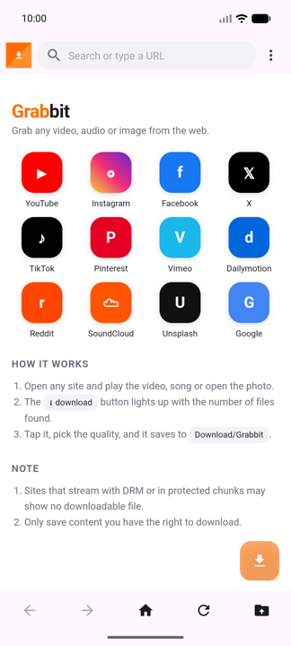
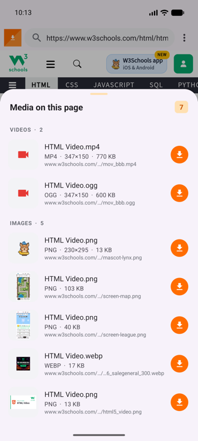
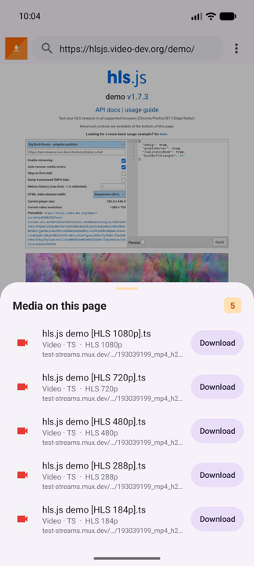
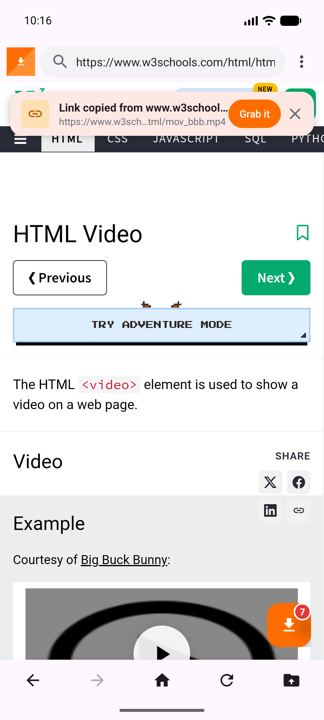
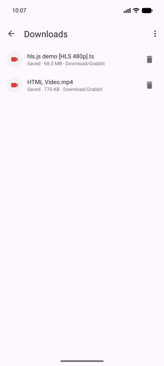

# Grabbit

**Grab any video, audio or image from the web.**

[](https://github.com/ChandraChaan/grabbit/releases/latest)


> Free, open source, no ads, no account. Works like VidMate or Snaptube but with a browser you control: if a page can play it, Grabbit can usually save it.

## Download

Grab the latest APK from the [Releases page](https://github.com/ChandraChaan/grabbit/releases/latest), install it, and open any site.

| Home | Media found | HLS qualities | Copied link | Downloads |
| --- | --- | --- | --- | --- |
|  |  |  |  |  |

Grabbit is an Android browser with a built-in media sniffer. Open any site, play a video or song or open a photo, and the floating download button lights up with the number of files it found. Tap it, pick the quality, and the file is saved to `Download/Grabbit`, even on sites that show no download option.

## Features

- Full browser (URL bar, search, back/forward, desktop mode, fullscreen video, share-to-Grabbit from other apps).
- Media detection on two layers:
  - **Network**: every request the page makes is inspected for video/audio files and HLS (`.m3u8`) playlists. YouTube `videoplayback` streams are recognised and labelled by quality.
  - **Page**: a script injected into every page watches `<video>`, `<audio>`, ``, `<source>`, Open Graph tags and anything the page plays or inserts later.
- Floating download button with a live count; a bottom sheet shows type, resolution, duration and file size for each item.
- HLS streams are expanded into their quality variants (1080p / 720p / ...) and downloaded segment by segment, including AES-128 encrypted streams and fMP4 init segments.
- Download engine: large files are split across up to 6 parallel connections and written at their offsets; HLS streams fetch 4 segments at a time and are stitched in order. Every connection retries and resumes from where it stopped. Requests carry the page's cookies, referer and user agent, so CDNs that block plain requests still work.
- Live speed, ETA, percentage and size in the notification and the Downloads list; cancel, retry, open and delete. Login walls and error pages are refused instead of being saved as "videos".
- Share any link from another app (YouTube, Instagram, X, Reddit…) straight to Grabbit: it opens the page and pops the download sheet.
- Copied a link? Open Grabbit and a "Grab it" banner offers to fetch it.
- Built-in player (Media3 ExoPlayer): play a stream before downloading, play saved files as a playlist, background audio with notification controls, double-tap seek, swipe for brightness and volume, speed, HLS quality picker, subtitles, rotate and picture-in-picture. Grabbit also registers as a system video/audio player.
- Firebase Analytics and Crashlytics.

## Roadmap

- [x] 1.0 Browser, sniffer, direct + HLS downloads
- [x] 1.1 Share-to-Grabbit, clipboard banner, thumbnails and sections
- [x] 1.2 Built-in video and audio player (play before download, play saved files, background audio, gestures, PiP)
- [x] 1.3 Download engine: parallel connections, resume, live speed and ETA

## Contributing

Issues and pull requests are welcome. If a site does not get detected, open an issue with the page URL.

## Build

```bash
./gradlew assembleRelease
```

Release signing reads `key.properties` (git-ignored) pointing at `keystore/grabbit-release.jks`. Without it the release build falls back to the debug key.

## Distribute testers a build

```bash
./gradlew assembleRelease
firebase appdistribution:distribute app/build/outputs/apk/release/app-release.apk \
  --app 1:600764554484:android:b73b028c123f9a4f6012a1 \
  --release-notes-file release-notes.txt --testers "dchandrachaan@gmail.com"
```

## Project layout

| Path | What |
| --- | --- |
| `app/src/main/assets/sniffer.js` | Script injected into pages to find media |
| `app/src/main/assets/home.html` | Start page with site shortcuts |
| `sniffer/` | `UrlSniffer` (URL heuristics), `MediaRegistry` (per-page list), `SnifferBridge` (JS interface) |
| `download/` | `DownloadService` (foreground orchestrator), `DirectDownloader` (parallel ranges + resume), `HlsDownloader` (parallel segments), `Hls` (m3u8 parser + AES), `Progress` (speed/ETA), `MediaSink` (MediaStore writer), `DownloadStore` (history) |
| `ui/` | `MainActivity` (browser), `MediaSheet` (found-media sheet), `DownloadsActivity` |
| `player/` | `PlayerActivity` (gestures, PiP, quality), `PlaybackService` (Media3 session, background audio) |

## Limits

- Sites that stream through DRM or Media Source Extensions with blob URLs (e.g. most of YouTube's adaptive streams) expose only separate video-only / audio-only streams; Grabbit labels these honestly.
- Only download content you have the right to save. Respect each site's terms.

## License

MIT
